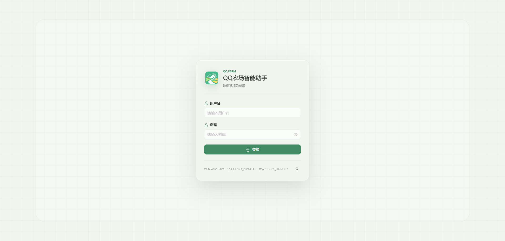
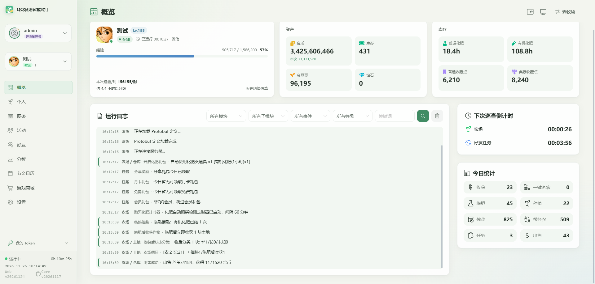
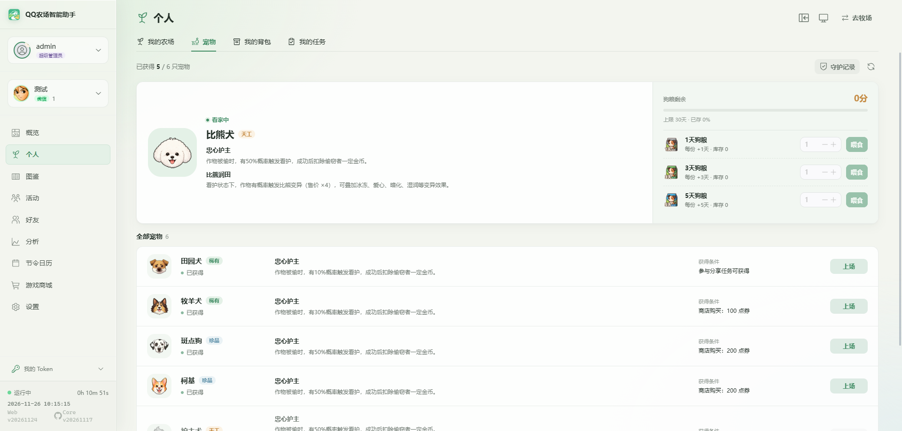

# QQ 农场助手

在一个 Web 面板里管理 QQ / 微信游戏账号，切换农场和牧场，分别配置每个账号的挂机策略。微信账号可选应用宝或 PCMgr 扫码授权，保存授权后可按设定在掉线时换 Code 并重连。

## 功能概览

| 模块 | 功能与操作入口 |
| --- | --- |
| 账号与登录 | 在左侧账号菜单添加、切换、启动或停止游戏账号，各账号独立保存挂机策略。支持输入 Code、QQ 扫码，以及应用宝或 PCMgr [微信登录](docs/第三方登录.md)。微信扫码可填写备注并保存授权，开启自动重连后可在掉线时换 Code 并恢复运行。 |
| 农场种植与巡田 | 在「概览」查看每块地的作物和成熟状态。在「设置 → 策略设置」按指定种子、作物等级、每小时经验或净利润选种，也可优先消耗背包种子。在「自动控制」开启自动播种收获、巡田浇水除草除虫、升级土地和卖果实，或设置普通肥、有机肥和催熟策略。 |
| 农场好友 | 在「好友」查看好友地块和访客记录，管理好友黑名单。在「自动控制」分别开启自动偷菜、帮忙、捣乱或自动通过好友申请，并设置申请等级门槛。偷菜作物黑名单在「分析」的作物列表中管理。 |
| 牧场养殖 | 在牧场「概览」查看动物、窝棚和待收获状态，在「策略」开启自动生产、收获、清理、补草或出售产物。可按等级、指定动物或优先消耗背包幼崽补栏，也可按生长阶段使用罐头，并设置牧草余量达到多少时补充。 |
| 牧场好友与集市 | 在牧场「好友」查看好友牧场和管理黑名单，在「策略」分别开启偷取产物、帮忙生产、清理、抚摸动物或放蚊子。牧场「游戏商城」可购买幼崽、饲料或罐头，也可在仓鼠集市用粑粑、松果兑换有机化肥。 |
| 个人、图鉴与分析 | 在「个人」查看背包，按可用操作使用道具或批量出售物品，也可给宠物喂狗粮、查看守护记录。在「图鉴」查看收集进度和奖励。农场「分析」可比较作物的每小时经验、利润及使用普通肥后的收益。 |
| 任务与活动 | 查看日常任务和奖励进度。农场可开启自动做任务、定时领取邮件奖励，牧场可开启自动领取任务和图鉴奖励、每日分享礼包及商城福利。在「节令日历」查看节令进度、参与开放的问答，其他活动操作以当期开放状态为准。 |
| 农场商城 | 在「游戏商城」查看和购买在售商品。神秘商人可按账号配置到货提醒和自动购买，并指定允许使用的货币。 |
| 运行与通知 | 在面板查看账号连接状态和运行日志。在「设置 → 系统设置」管理服务器地址、时区和设备参数，选择通知渠道并配置账号离线提醒和离线清理。 |

## 项目截图

以下截图用于展示各页面。扫码入口和控件以当前面板为准。

| | |
| --- | --- |
|  |  |
|  |  |
|  |  |
|  |  |
|  |  |

## 部署

### 环境要求

| 运行方式 | 需要准备 |
| --- | --- |
| 源码运行 | Node.js 20.19.x 或 22.12 及以上版本、pnpm 10.30.2。通过 Git 获取和更新源码时需要 Git，使用 Linux 管理脚本时需要 Bash。 |
| Docker Compose | 启用 BuildKit 的 Docker 和 Docker Compose v2。通过 Git 获取和更新源码时需要 Git。Node.js 和 pnpm 由容器镜像提供。 |
| 二进制运行 | 与系统和架构匹配的可执行文件。当前打包目标为 Windows x64、Linux x64、macOS Intel 和 macOS Apple Silicon。运行机器无需另装 Node.js 或 pnpm，从源码打包时需满足源码运行的构建环境。 |

面板默认使用 `3007` 端口。启动前确认端口可用、数据目录可写，运行环境能够访问游戏服务。

### 源码运行

从源码目录执行：

```bash
corepack enable
pnpm install --frozen-lockfile
pnpm dev
```

打开 `http://localhost:3007`。Linux 长期运行可用 `bash start.sh` 启动，`bash status.sh` 查看状态。更新时先执行 `git pull --ff-only origin master`，再执行 `bash update.sh` 构建并应用当前源码。需要回滚时可用 `bash rollback.sh all`。

Linux 管理脚本会启动独立的会话宿主。仅更新后端并接回已有在线会话，需保持宿主运行且版本兼容。`bash stop.sh all` 会结束全部服务与会话。

| Linux 管理操作 | 命令 |
| --- | --- |
| 单独更新前端或后端 | `bash update.sh web` 或 `bash update.sh backend` |
| 查看进程和会话状态 | `bash status.sh --json` |
| 回退前端、后端或配套版本 | `bash rollback.sh web`、`bash rollback.sh backend` 或 `bash rollback.sh all` |
| 暂停后端并保留游戏会话 | `bash stop.sh backend`，再用 `bash start.sh` 恢复面板 |
| 查看完整构建输出 | 在启动或更新命令后加 `--verbose` |

通过 Linux 管理脚本启动的部署，也可在「设置 → 系统设置 → 版本更新」检查更新，选择仅拉取代码或拉取并更新。回滚可用性取决于历史版本备份及其与当前会话宿主的兼容性。

### Docker Compose

也可以直接使用 [GHCR 发布镜像](https://github.com/Foch0x97/qq-farm-bot/pkgs/container/qq-farm-bot)。镜像标签与 GitHub Releases 的版本号一致，支持 Linux amd64 和 arm64。获取仓库后，在根目录 `.env` 中设置：

```dotenv
FARM_IMAGE=ghcr.io/foch0x97/qq-farm-bot:v1.0.1
```

执行以下命令拉取并启动两个服务。更新时把 `FARM_IMAGE` 改为所需版本，再执行同一组命令。

```bash
docker compose pull
docker compose up -d --no-build
docker compose ps
```

如需从源码构建，保持 `FARM_IMAGE` 未设置，并执行：

```bash
git clone https://github.com/Foch0x97/qq-farm-bot.git
cd qq-farm-bot
DOCKER_BUILDKIT=1 docker compose up -d --build
docker compose ps
```

浏览器访问 `http://服务器IP:3007`。如需改宿主机端口，编辑项目根目录 `.env` 中的 `PORT`，容器内端口仍为 `3007`。

Compose 启动 `qq-farm-bot`（面板与账号任务）和 `session-host`（游戏会话宿主）。两者共享运行目录，主服务等待宿主健康后启动。首次部署应确认两个服务都正常，再登录面板。

| 默认卷 | 用途 |
| --- | --- |
| `qq-farm-data` | 管理员设置、账号配置及授权数据 |
| `qq-farm-logs` | 运行日志 |
| `qq-farm-runtime` | 会话宿主数据和服务间通信文件 |

#### 更新

在现有项目目录依次执行以下命令，沿用原端口和数据挂载。

```bash
git pull --ff-only origin master
docker compose config --quiet
DOCKER_BUILDKIT=1 docker compose up -d --build
docker compose ps
```

拉取成功且配置检查通过后再构建，最后查看两个服务的状态。会话宿主若随构建重建，已有游戏会话可能需要重新登录。

仅更新面板和后端时，确认新后端与现有宿主兼容后，可先执行 `DOCKER_BUILDKIT=1 docker compose build qq-farm-bot`，再执行 `docker compose up -d --no-deps qq-farm-bot`。用 `docker compose logs -f` 查看日志。需要停服并移除容器时，使用 `docker compose down` 保留命名卷。

本地修改过 Compose 时，保留原端口和数据挂载。若旧检出还停留在主分支历史重建之前，先备份本地改动和数据，并对齐到当前仓库历史，再恢复常规拉取。换机或迁移前停服并备份实际挂载的目录或数据卷，授权文件和密钥要一起保存。详见[配置存储与备份](docs/config-storage.md)。

### 二进制运行

从 [GitHub Releases](https://github.com/Foch0x97/qq-farm-bot/releases) 下载对应平台的压缩包，解压后启动程序。`checksums.txt` 可用于核对压缩包的 SHA-256。

在具备源码构建环境的机器上，从项目根目录执行：

```bash
corepack enable
pnpm install --frozen-lockfile
pnpm package:release
```

打包目标为 Windows x64、Linux x64、macOS Intel 和 macOS Apple Silicon，输出目录为 `core/dist/bin/`。运行与系统匹配的可执行文件，再打开 `http://localhost:3007`。Linux 和 macOS 如缺少执行权限，先用 `chmod +x` 授权。运行机器无需另装 Node.js，默认数据目录为可执行文件同级的 `data/`。更新时先停程序，再替换可执行文件并保留数据目录。

## 首次使用

1. 使用默认管理员 `admin` / `admin` 登录，然后到「设置 → 系统设置」修改密码。
2. 从左侧账号菜单选择「添加账号」，按游戏账号所属平台登录。微信选择「微信登录」，可切换应用宝或 PCMgr。QQ 扫码需先配置兼容的 [qq-miniapp-auth 服务](https://github.com/liyangpengs/qq-miniapp-auth)及签名。已取得 Code 的账号也可手动输入 Code。
3. 微信扫码时备注可留空。新增账号默认用微信昵称，编辑账号留空时保留原备注。扫码确认后看弹窗里的授权保存结果和连接状态，确认在线后再开启所需的农场、牧场和好友策略。
4. 已保存授权的微信账号可开启掉线自动重连。默认离线 3 分钟后尝试，每次掉线最多重试 3 次。授权失效时可能需要重新扫码。

面板使用单管理员管理多个游戏账号。各账号分别保存自动化配置，推送渠道在「系统设置 → 通知设置」统一维护。

## 配置说明

### 环境变量

| 变量 | 默认值 | 用途 |
| --- | --- | --- |
| `ADMIN_PORT` | `3007` | 源码或二进制启动时的面板监听端口。默认 Compose 配置把容器内端口设为 `3007`。 |
| `PORT` | `3007` | Compose 宿主机映射端口，在项目根目录的 `.env` 设置。 |
| `FARM_IMAGE` | `qq-farm-bot:latest` | Compose 的面板和会话宿主共用的镜像名。使用 GHCR 发布镜像时设置为所需版本。 |
| `TZ` | `Asia/Shanghai` | Compose 容器时区，在根目录的 `.env` 设置。游戏任务使用面板里的「系统时区」。 |
| `NODE_ENV` | Compose 固定为 `production` | 在 Compose 中启用生产运行环境。 |
| `LOG_LEVEL` | `info` | 后端日志级别。Compose 中如需覆盖，将变量加入对应服务的 `environment`。 |
| `FARM_DATA_DIR` | 见下方数据位置 | 指定后端数据目录。 |
| `NODE_IMAGE` / `PNPM_VERSION` / `NPM_REGISTRY` | `node:20.19.6-alpine3.21` / `10.30.2` / `https://registry.npmjs.org/` | Compose 构建时使用的基础镜像、pnpm 版本和依赖源，可通过根目录的 `.env` 覆盖。 |

例如，Docker Compose 要把面板映射到宿主机的 `3008`，在 `.env` 设置 `PORT=3008`。源码运行时，可在 Windows CMD 执行 `set ADMIN_PORT=3008`，再在同一窗口执行 `pnpm dev`。

### 系统设置

| 面板位置 | 配置项 |
| --- | --- |
| 运行环境 | 游戏服务器地址、系统时区，以及 QQ 和微信的客户端版本、设备标识、系统版本、内存、网络与 User-Agent。礼包、任务、安静时段和日志以面板系统时区为准。 |
| 登录设置 | 开关微信和 QQ 扫码入口。启用 QQ 扫码前填写 NapCat 兼容接口地址和签名。微信登录的渠道、备注和自动重连在账号弹窗设置。 |
| 通知设置 | 选择要推送的事件，添加渠道并按渠道填写所需 Token 或地址，保存后可发送测试通知。`离线删除账号 (秒)` 设为 `0` 时关闭自动清理。神秘商人提醒还要在对应游戏账号的「自动控制」开启。 |
| 修改管理员密码 | 输入当前密码、新密码和确认密码。初始化使用默认管理员，修改后的密码配置保存在实例数据目录的 `admin.json`。 |

### 农场种植策略

在「设置 → 策略设置」为当前账号选择种植策略。

| 面板名称 | 行为 |
| --- | --- |
| 优先种植种子 | 优先种指定种子，不可用时按回退策略选择。 |
| 最高等级作物 | 选择当前可种植的高等级作物。 |
| 最大经验/时 | 按每小时经验选择，默认策略。 |
| 最大普通肥经验/时 | 按使用普通肥后的每小时经验选择。 |
| 最大净利润/时 | 按每小时净利润选择。 |
| 最大普通肥净利润/时 | 按使用普通肥后的每小时净利润选择。 |
| 背包种子优先 | 按设置的优先级使用背包种子，用完后按回退策略选择。 |

### 农场施肥模式

在「设置 → 自动控制」选择施肥策略，并按需设置土地范围、补肥和自动购买化肥。

| 模式 | 行为 |
| --- | --- |
| 不施肥 | 关闭自动施肥。 |
| 普通 + 有机 | 同时启用普通肥和有机肥。 |
| 仅普通化肥 / 仅有机化肥 | 仅用选定肥料。 |
| 仅普通化肥催熟 / 仅有机化肥催熟 | 只在进入快成熟阈值后使用选定肥料。 |
| 智能施肥（普通 + 有机催熟） | 常规使用普通肥，临近成熟时使用有机肥催熟。 |

新账号默认不施肥。催熟使用所选土地范围和「快成熟判定秒数」，默认阈值为 300 秒。两种仅催熟模式对每季分别判断，播种时不提前施肥。手动施肥在农场界面单独操作。

### 牧场策略

在牧场「策略」页设定巡查间隔、普通和有机罐头的喂养时机及补草阈值。补栏可按已解锁等级、指定动物或优先使用背包幼崽，窝与棚可分别指定动物。自动购买牧草、补栏及升级建筑会使用金券，可按账号分别开启。

### 图鉴配置

农场图鉴使用 [Illustrated.json](core/src/gameConfig/Illustrated.json) 的果实 ID、分类和排序字段。超变图鉴的等级加成来自 [BuffCfg.json](core/src/gameConfig/BuffCfg.json) 中的「超变升级」条目。各类图鉴、宝典与藏品的计算和数据来源见[专题文档](docs/collections-20261101.md)。

| 配置字段 | 含义 |
| --- | --- |
| `Illustrated.json` 的 `param`、`type`、`illustrated_type`、`sort` | 依次用于匹配果实 ID、区分果实分类、区分图鉴类型和控制展示顺序。 |
| `BuffCfg.json` 的 `source_type`、`source_param` | 加成来源和生效等级。 |
| `BuffCfg.json` 的 `attr_id`、`attr_value` | 加成属性和值。数值大于 10 时按千分值显示概率，例如 100 显示为 10%；其余值按数量显示。 |

## 数据与备份

| 运行方式 | 默认数据位置 |
| --- | --- |
| 源码运行 | `core/data/` |
| Docker Compose | 容器的 `/app/core/data` 对应 `qq-farm-data` 命名卷，日志和会话运行目录另有独立卷。 |
| 二进制运行 | 可执行文件同级的 `data/`。 |

升级或迁移前，按实际路径停服备份数据。微信授权文件和密钥要配套保存，同时保留账号列表、管理员设置和逐账号配置。详见[配置存储、迁移与恢复](docs/config-storage.md)。

## 技术栈

| 模块 | 技术与用途 |
| --- | --- |
| Web 面板 | Vue 3、TypeScript、Vite。Naive UI 和 UnoCSS 用于界面，Vue Router 管理页面路由，Pinia 管理状态。 |
| 后端 | Node.js、TypeScript、Express。Express 提供管理 API，Socket.IO 向面板推送账号状态和日志，Winston 记录服务端日志。 |
| 游戏连接与账号任务 | `ws` 建立游戏 WebSocket 连接，`protobufjs` 编解码 Protobuf 消息。Node.js 子进程和 Worker 线程承载账号任务及游戏连接，独立会话宿主通过本地 IPC 与后端通信。 |
| 数据存储 | 管理员、账号及设置保存在本地 JSON 文件中。微信授权单独加密保存。 |
| 构建与发布 | pnpm Workspace 管理多包仓库，Turborepo 调度构建任务。Docker Compose 用于容器部署，`pkg` 用于生成独立可执行文件。 |
| 开发与检查 | ESLint 检查代码，`tsc` 和 `vue-tsc` 检查类型，前后端测试使用 Node.js 内置的 `node:test`。 |

## 项目结构

Web 面板调用后端 API 管理账号，通过 Socket.IO 接收状态和日志。后端为各账号启动独立 Worker 执行业务任务。配置了独立会话宿主时，由宿主维持游戏连接，Worker 通过本地通信接入。

| 路径 | 职责 |
| --- | --- |
| [`web/src/views/`](web/src/views) | 农场、牧场、好友、活动、商城和设置页面 |
| [`web/src/router/`](web/src/router) | 农场与牧场菜单及页面路由 |
| [`web/src/components/`](web/src/components) | 账号弹窗、微信登录界面和公共表单控件 |
| [`web/src/stores/`](web/src/stores) | 账号状态、日志和页面数据 |
| [`core/src/controllers/`](core/src/controllers) | 面板 API、管理鉴权和实时通信 |
| [`core/src/runtime/`](core/src/runtime) | 账号工作进程、启停、状态分发及第三方掉线续期 |
| [`core/src/session/`](core/src/session) | 独立会话宿主、连接接管及通信 |
| [`core/src/core/worker.ts`](core/src/core/worker.ts) | 单账号任务调度与运行状态 |
| [`core/src/services/`](core/src/services) | 农场、牧场、登录、好友、活动和商城业务 |
| [`core/src/models/`](core/src/models) | 管理员、账号及配置存储 |
| [`core/src/proto/`](core/src/proto)、[`core/src/gameConfig/`](core/src/gameConfig) | 游戏协议定义和资源配置 |
| [`packages/session-contract/`](packages/session-contract) | 服务间共享的消息格式、运行路径和进程锁 |
| [`docker-compose.yml`](docker-compose.yml)、[`core/Dockerfile`](core/Dockerfile) | 双服务部署和镜像构建 |
| [`tools/`](tools)、[`docs/`](docs/README.md) | 部署工具与专题文档 |

## 开发与检查

```bash
pnpm build:contract
pnpm -C core test
pnpm typecheck:web
pnpm -C web test
pnpm build
```

开发时可分别运行 `pnpm dev:web` 和 `pnpm dev:core`。本地运行数据默认在 `core/data/`，账号授权及私有日志请勿提交到仓库。

| 常用命令 | 用途 |
| --- | --- |
| `pnpm dev` | 先构建前端，再启动后端开发服务。 |
| `pnpm dev:web` / `pnpm dev:core` | 分别启动 Vite 和后端。仅运行后端且需要由其托管面板时，先运行 `pnpm build:web`。 |
| `pnpm lint` | 检查并自动修复前后端代码风格。 |
| `pnpm -C core typecheck` / `pnpm typecheck:web` | 检查后端和前端的类型。 |
| `pnpm build:web` / `pnpm build:core` | 分别构建网页和后端。 |
| `pnpm -C web build:compressed` / `pnpm -C web build:analyze` | 构建时额外输出预压缩文件或包体分析报告。 |
| `pnpm -C core test` / `pnpm -C web test` | 分别执行后端和前端测试。 |
| `pnpm package:release` | 构建并打包各平台的可执行文件。 |

### 清理工作区

Windows 打包清理脚本为 `clean-for-pack.bat`，默认清理依赖、构建产物及运行数据。要保留 `core/data`，使用 `clean-for-pack.bat --keep-data`。Linux/macOS 的 `clean.sh` 会在停服后删除项目根目录中除 `.git` 之外的全部内容，包含源码与运行数据，仅用于准备重新检出的工作区。

## 项目文档

- [微信登录与自动续期](docs/第三方登录.md)
- [配置存储、迁移与缓存](docs/config-storage.md)
- [工具脚本与协议抓包分析](docs/tools.md)
- [图鉴、变异宝典与藏品](docs/collections-20261101.md)
- [网络并发模型](docs/network-concurrency.md)
- [商城与神秘商人](docs/shop-protocols.md)
- [全部专题文档](docs/README.md)

## 免责声明

本项目仅供学习与研究。使用前请了解游戏服务条款及账号风险。
