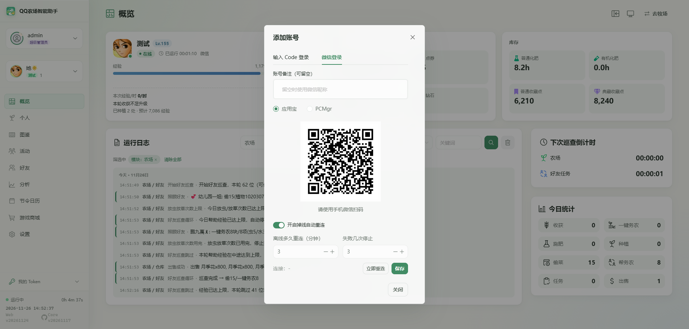
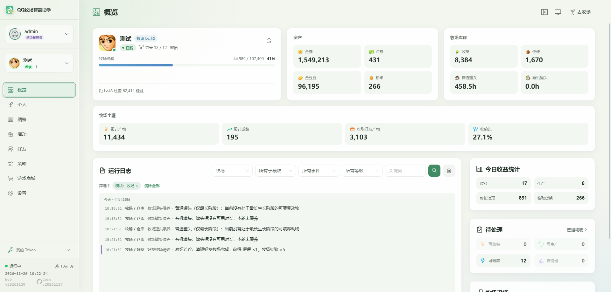
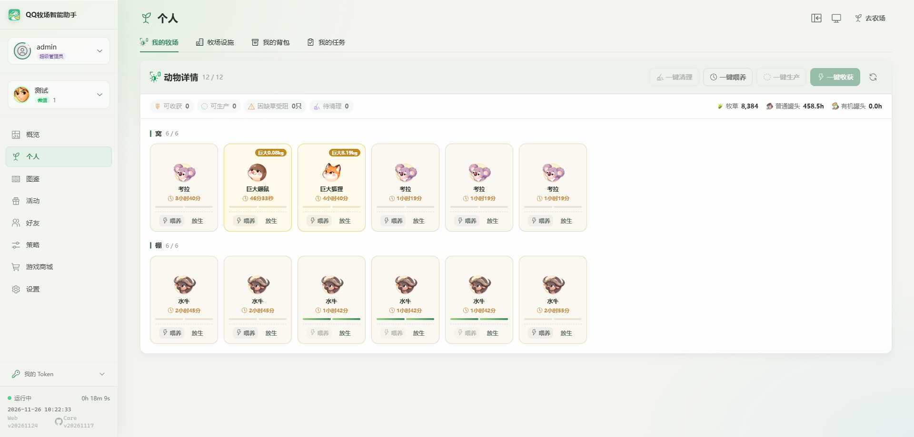
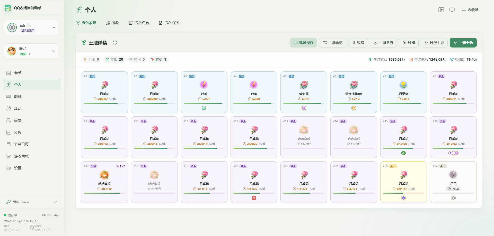
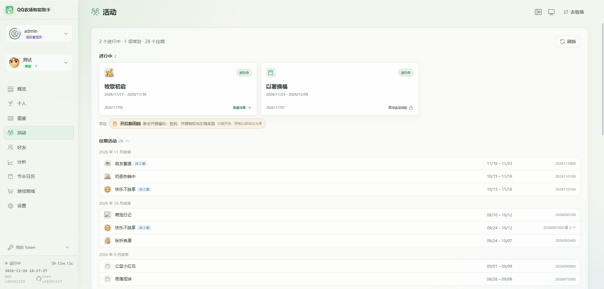
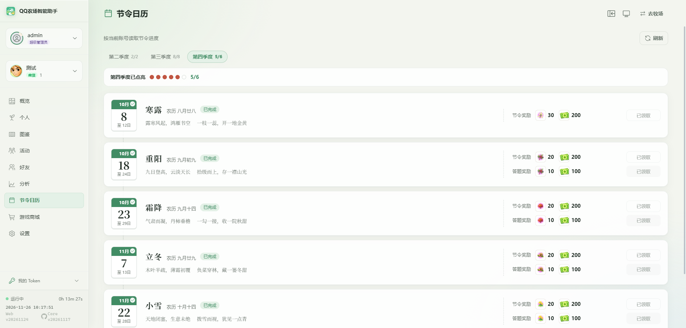
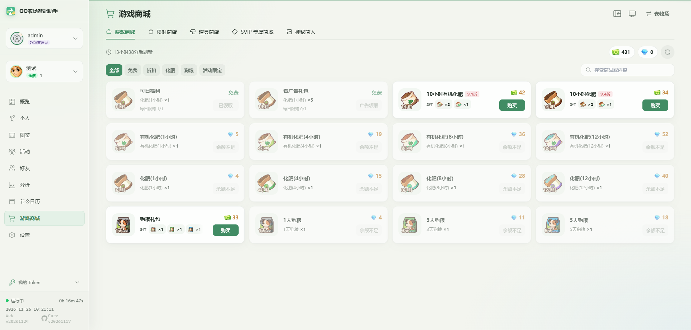

<h1 align="center">QQ 农场助手</h1>

<p align="center">在一个 Web 面板管理 QQ 和微信账号，自动打理农场与牧场。</p>

<p align="center">
  <a href="https://github.com/Foch0x97/qq-farm-bot/releases"></a>
  <a href="https://hub.docker.com/r/foch0x97/qq-farm-bot"></a>
  <a href="https://github.com/Foch0x97/qq-farm-bot/actions/workflows/verify.yml"></a>
</p>

<p align="center"><strong><a href="https://github.com/Foch0x97/qq-farm-bot/releases">下载最新版本</a></strong> · <a href="#docker-compose">Docker 部署</a> · <a href="#源码运行">源码运行</a></p>

[功能概览](#功能概览) · [快速开始](#快速开始) · [配置说明](#配置说明) · [数据与备份](#数据与备份) · [开发参考](#开发参考) · [项目文档](#项目文档)

## 功能概览

[账号登录](#账号登录) · [农场与牧场](#农场与牧场) · [背包与图鉴](#背包与图鉴) · [宠物与活动](#宠物与活动) · [日历与商城](#日历与商城)

### 账号登录

在左侧账号菜单添加、切换、启动或停止账号。每个账号独立保存挂机策略，面板统一显示连接状态和运行日志。

- **微信**　通过应用宝或 PCMgr 扫码，备注可留空。保存授权并开启自动重连后，掉线时可自动换 Code 并恢复挂机。[微信登录说明](docs/第三方登录.md)
- **QQ 与 Code**　QQ 支持配置扫码服务后登录。已有 Code 的账号也可直接输入。

| 面板登录 | 微信登录与掉线重连 |
| :---: | :---: |
| [](docs/images/screenshots/01.png) | [](docs/images/screenshots/02.png) |

### 农场与牧场

| 操作 | 农场 | 牧场 |
| --- | --- | --- |
| 日常打理 | 播种、收获、浇水、除草除虫、施肥催熟、升级土地和出售果实 | 生产、收获、清理、补草和出售产物 |
| 挂机策略 | 按指定种子、作物等级、每小时经验或净利润选种，可优先使用背包种子 | 按等级或指定动物补栏，可优先使用背包幼崽、分阶段喂罐头，并设置补草余量 |
| 好友互动 | 查看好友地块和访客，偷菜、帮忙、捣乱，按等级通过好友申请 | 查看好友牧场，偷取产物、帮忙生产、清理、抚摸动物或放蚊子 |

农场在「设置 → 策略设置」选种，在「自动控制」开启任务。牧场从「策略」调整养殖和好友操作。两边都能管理好友黑名单，农场还可在「分析」单独排除不想偷取的作物。

| 农场概览 | 牧场概览 |
| :---: | :---: |
| [](docs/images/screenshots/03.png) | [](docs/images/screenshots/04.png) |

### 背包与图鉴

在「个人」查看背包、使用道具或批量出售物品。「图鉴」记录收集进度和奖励，「分析」可比较不同作物的每小时经验、利润和施用普通肥后的收益。

| 个人页（一） | 个人页（二） |
| :---: | :---: |
| [](docs/images/screenshots/05.png) | [](docs/images/screenshots/06.png) |

### 宠物与活动

在「个人」喂狗粮、查看守护记录。在活动页查看任务和奖励进度。农场可自动做任务、定时领取邮件奖励，牧场可自动领取任务和图鉴奖励、每日分享礼包及商城福利。

| 宠物 | 活动中心 |
| :---: | :---: |
| [](docs/images/screenshots/07.png) | [](docs/images/screenshots/08.png) |

### 日历与商城

在「节令日历」查看节令进度，参与当期开放的问答。农场商城支持购买在售商品，也可给神秘商人设置到货提醒、自动购买和可用货币。牧场商城出售幼崽、饲料和罐头，仓鼠集市可用粑粑、松果兑换有机化肥。

| 节气日历 | 游戏商城 |
| :---: | :---: |
| [](docs/images/screenshots/09.png) | [](docs/images/screenshots/10.png) |

## 快速开始

### 环境要求

| 运行方式 | 需要准备 |
| --- | --- |
| 源码运行 | Node.js 20.19.x 或 22.12 及以上版本、pnpm 10.30.2。通过 Git 获取和更新源码时需要 Git，使用 Linux 管理脚本时需要 Bash。 |
| Docker Compose | Docker 和 Docker Compose v2。需要自己构建镜像时启用 BuildKit。 |
| 下载后运行 | 从 [Releases](https://github.com/Foch0x97/qq-farm-bot/releases) 下载与系统和架构匹配的可执行文件。运行机器无需另装 Node.js 或 pnpm。 |

面板默认使用 `3007` 端口。启动前确认端口可用、数据目录可写，运行环境能够访问游戏服务。

### 源码运行

从源码目录执行：

```bash
corepack enable
pnpm install --frozen-lockfile
pnpm dev
```

打开 `http://localhost:3007`。

### Linux 后台管理

Linux 长期运行可用 `bash start.sh` 启动，`bash status.sh` 查看状态。更新时先执行 `git pull --ff-only origin master`，再执行 `bash update.sh` 构建并应用当前源码。需要回滚时可用 `bash rollback.sh all`。

Linux 管理脚本会启动独立的会话宿主。仅更新后端并接回已有在线会话，需保持宿主运行且版本兼容。`bash stop.sh all` 会结束全部服务与会话。

| Linux 管理操作 | 命令 |
| --- | --- |
| 单独更新前端或后端 | `bash update.sh web` 或 `bash update.sh backend` |
| 查看进程和会话状态 | `bash status.sh --json` |
| 回退前端、后端或配套版本 | `bash rollback.sh web`、`bash rollback.sh backend` 或 `bash rollback.sh all` |
| 暂停后端并保留游戏会话 | `bash stop.sh backend`，再用 `bash start.sh` 恢复面板 |
| 查看完整构建输出 | 在启动或更新命令后加 `--verbose` |

通过 Linux 管理脚本启动的部署，也可在「设置 → 系统设置 → 版本更新」检查更新，选择仅拉取代码或拉取并更新。回滚可用性取决于历史版本备份及其与当前会话宿主的兼容性。

### Docker Compose

Compose 默认从 [Docker Hub](https://hub.docker.com/r/foch0x97/qq-farm-bot) 拉取 `foch0x97/qq-farm-bot:latest`，支持 Linux amd64 和 arm64。首次部署执行：

```bash
git clone https://github.com/Foch0x97/qq-farm-bot.git
cd qq-farm-bot
docker compose pull
docker compose up -d --no-build
docker compose ps
```

如需固定到指定版本，在项目根目录的 `.env` 设置 `FARM_IMAGE=docker.io/foch0x97/qq-farm-bot:v1.0.1`。镜像标签与 GitHub Releases 的版本号一致。

浏览器访问 `http://服务器IP:3007`。如需改宿主机端口，编辑项目根目录 `.env` 中的 `PORT`，容器内端口仍为 `3007`。

Compose 启动 `qq-farm-bot`（面板与账号任务）和 `session-host`（游戏会话宿主）。两者共享运行目录，主服务等待宿主健康后启动。首次部署应确认两个服务都正常，再登录面板。

| 默认卷 | 用途 |
| --- | --- |
| `qq-farm-data` | 管理员设置、账号配置及授权数据 |
| `qq-farm-logs` | 运行日志 |
| `qq-farm-runtime` | 会话宿主数据和服务间通信文件 |

### 首次使用

1. 使用默认管理员 `admin` / `admin` 登录，然后到「设置 → 系统设置」修改密码。
2. 从左侧账号菜单选择「添加账号」，按游戏账号所属平台登录。微信选择「微信登录」，可切换应用宝或 PCMgr。QQ 扫码需先配置兼容的 [qq-miniapp-auth 服务](https://github.com/liyangpengs/qq-miniapp-auth)及签名。已取得 Code 的账号也可手动输入 Code。
3. 微信扫码时备注可留空。新增账号默认用微信昵称，编辑账号留空时保留原备注。扫码确认后看弹窗里的授权保存结果和连接状态，确认在线后再开启所需的农场、牧场和好友策略。
4. 已保存授权的微信账号可开启掉线自动重连。默认离线 3 分钟后尝试，每次掉线最多重试 3 次。授权失效时可能需要重新扫码。

面板使用单管理员管理多个游戏账号。各账号分别保存自动化配置，推送渠道在「系统设置 → 通知设置」统一维护。

## 配置说明

[系统设置](#系统设置) · [环境变量](#环境变量) · [图鉴配置](#图鉴配置)

### 环境变量

| 变量 | 默认值 | 用途 |
| --- | --- | --- |
| `ADMIN_PORT` | `3007` | 源码或可执行文件启动时的面板监听端口。默认 Compose 配置把容器内端口设为 `3007`。 |
| `PORT` | `3007` | Compose 宿主机映射端口，在项目根目录的 `.env` 设置。 |
| `FARM_IMAGE` | `docker.io/foch0x97/qq-farm-bot:latest` | Compose 的面板和会话宿主共用的镜像名。可指定 Docker Hub 版本或本地构建的镜像。 |
| `TZ` | `Asia/Shanghai` | Compose 容器时区，在根目录的 `.env` 设置。游戏任务使用面板里的「系统时区」。 |
| `NODE_ENV` | Compose 固定为 `production` | 在 Compose 中启用生产运行环境。 |
| `LOG_LEVEL` | `info` | 后端日志级别。Compose 中如需覆盖，将变量加入对应服务的 `environment`。 |
| `FARM_DATA_DIR` | 见下方数据位置 | 指定后端数据目录。 |
| `NODE_IMAGE` / `PNPM_VERSION` / `NPM_REGISTRY` | `node:20.19.6-alpine3.21` / `10.30.2` / `https://registry.npmjs.org/` | Compose 构建时使用的基础镜像、pnpm 版本和依赖源，可通过根目录的 `.env` 覆盖。 |

例如，Docker Compose 要把面板映射到宿主机的 `3008`，在 `.env` 设置 `PORT=3008`。源码运行时，可在 Windows CMD 执行 `set ADMIN_PORT=3008`，再在同一窗口执行 `pnpm dev`。

### 系统设置

| 面板位置 | 配置项 |
| --- | --- |
| 运行环境 | 游戏服务器地址、系统时区，以及 QQ 和微信的客户端版本、设备标识、系统版本、内存、网络与 User-Agent。礼包、任务、安静时段和日志以面板系统时区为准。 |
| 登录设置 | 开关微信和 QQ 扫码入口。启用 QQ 扫码前填写 NapCat 兼容接口地址和签名。微信登录的渠道、备注和自动重连在账号弹窗设置。 |
| 通知设置 | 选择要推送的事件，添加渠道并按渠道填写所需 Token 或地址，保存后可发送测试通知。`离线删除账号 (秒)` 设为 `0` 时关闭自动清理。神秘商人提醒还要在对应游戏账号的「自动控制」开启。 |
| 修改管理员密码 | 输入当前密码、新密码和确认密码。初始化使用默认管理员，修改后的密码配置保存在实例数据目录的 `admin.json`。 |

### 图鉴配置

农场图鉴使用 [Illustrated.json](core/src/gameConfig/Illustrated.json) 的果实 ID、分类和排序字段。超变图鉴的等级加成来自 [BuffCfg.json](core/src/gameConfig/BuffCfg.json) 中的「超变升级」条目。各类图鉴、宝典与藏品的计算和数据来源见[专题文档](docs/collections-20261101.md)。

| 配置字段 | 含义 |
| --- | --- |
| `Illustrated.json` 的 `param`、`type`、`illustrated_type`、`sort` | 依次用于匹配果实 ID、区分果实分类、区分图鉴类型和控制展示顺序。 |
| `BuffCfg.json` 的 `source_type`、`source_param` | 加成来源和生效等级。 |
| `BuffCfg.json` 的 `attr_id`、`attr_value` | 加成属性和值。数值大于 10 时按千分值显示概率，例如 100 显示为 10%；其余值按数量显示。 |

## 数据与备份

| 运行方式 | 默认数据位置 |
| --- | --- |
| 源码运行 | `core/data/` |
| Docker Compose | 容器的 `/app/core/data` 对应 `qq-farm-data` 命名卷，日志和会话运行目录另有独立卷。 |
| 下载后运行 | 可执行文件同级的 `data/`。 |

升级或迁移前，按实际路径停服备份数据。微信授权文件和密钥要配套保存，同时保留账号列表、管理员设置和逐账号配置。详见[配置存储、迁移与恢复](docs/config-storage.md)。

## 开发参考

### 技术栈

| 模块 | 技术与用途 |
| --- | --- |
| Web 面板 | Vue 3、TypeScript、Vite。Naive UI 和 UnoCSS 用于界面，Vue Router 管理页面路由，Pinia 管理状态。 |
| 后端 | Node.js、TypeScript、Express。Express 提供管理 API，Socket.IO 向面板推送账号状态和日志，Winston 记录服务端日志。 |
| 游戏连接与账号任务 | `ws` 建立游戏 WebSocket 连接，`protobufjs` 编解码 Protobuf 消息。Node.js 子进程和 Worker 线程承载账号任务及游戏连接，独立会话宿主通过本地 IPC 与后端通信。 |
| 数据存储 | 管理员、账号及设置保存在本地 JSON 文件中。微信授权单独加密保存。 |
| 构建与发布 | pnpm Workspace 管理多包仓库，Turborepo 调度构建任务。Docker Compose 用于容器部署，`pkg` 用于生成独立可执行文件。 |
| 开发与检查 | ESLint 检查代码，`tsc` 和 `vue-tsc` 检查类型，前后端测试使用 Node.js 内置的 `node:test`。 |

### 项目结构

Web 面板调用后端 API 管理账号，通过 Socket.IO 接收状态和日志。后端为各账号启动独立 Worker 执行业务任务。配置了独立会话宿主时，由宿主维持游戏连接，Worker 通过本地通信接入。

```text
qq-farm-bot/
├── core/                       # 后端与游戏连接
│   ├── src/
│   │   ├── controllers/        # 面板 API、鉴权和实时通信
│   │   ├── core/               # 单账号 Worker 与任务调度
│   │   ├── runtime/            # 多账号运行时、状态同步和掉线重连
│   │   ├── session/            # 会话宿主、连接接管和本地通信
│   │   ├── services/           # 农场、牧场、好友、活动、商城和登录
│   │   ├── proto/              # Protobuf 消息定义
│   │   ├── gameConfig/         # 作物、道具、等级和图鉴等数据
│   │   └── models/             # 管理员、账号及配置存储
│   └── Dockerfile              # 双服务共用的镜像构建
├── web/                        # Vue 3 Web 面板
│   └── src/
│       ├── components/         # 账号弹窗、微信登录和公共组件
│       ├── router/             # 农场与牧场菜单和路由
│       ├── stores/             # 账号状态、日志和页面数据
│       └── views/              # 各功能页面
├── packages/session-contract/  # 服务间消息、运行路径和进程锁
├── tools/                      # 部署管理、资源下载和协议分析
├── docs/                       # 专题文档和截图
├── docker-compose.yml          # 双服务部署配置
├── pnpm-workspace.yaml         # 工作区配置
└── package.json                # 构建、测试和打包入口
```

### 版本规则

Web UI 有改动时，同一次提交更新 `web/package.json` 的 `version`，沿用 `YYYYMMDD` 日期格式。GitHub Releases 与 Docker Hub 使用同一个 `v主版本.次版本.修订号` 发布标签。

### 开发与检查

```bash
pnpm build:contract
pnpm -C core test
pnpm typecheck:web
pnpm -C web test
pnpm build
```

开发时可分别运行 `pnpm dev:web` 和 `pnpm dev:core`。本地运行数据默认在 `core/data/`，账号授权及私有日志请勿提交到仓库。

| 常用命令 | 用途 |
| --- | --- |
| `pnpm dev` | 先构建前端，再启动后端开发服务。 |
| `pnpm dev:web` / `pnpm dev:core` | 分别启动 Vite 和后端。仅运行后端且需要由其托管面板时，先运行 `pnpm build:web`。 |
| `pnpm lint` | 检查并自动修复前后端代码风格。 |
| `pnpm -C core typecheck` / `pnpm typecheck:web` | 检查后端和前端的类型。 |
| `pnpm build:web` / `pnpm build:core` | 分别构建网页和后端。 |
| `pnpm -C web build:compressed` / `pnpm -C web build:analyze` | 构建时额外输出预压缩文件或包体分析报告。 |
| `pnpm -C core test` / `pnpm -C web test` | 分别执行后端和前端测试。 |
| `pnpm package:release` | 构建并打包各平台的可执行文件。 |

#### 清理工作区

Windows 打包清理脚本为 `clean-for-pack.bat`，默认清理依赖、构建产物及运行数据。要保留 `core/data`，使用 `clean-for-pack.bat --keep-data`。Linux/macOS 的 `clean.sh` 会在停服后删除项目根目录中除 `.git` 之外的全部内容，包含源码与运行数据，仅用于准备重新检出的工作区。

## 项目文档

- [微信登录与自动续期](docs/第三方登录.md)
- [配置存储、迁移与缓存](docs/config-storage.md)
- [工具脚本与协议抓包分析](docs/tools.md)
- [图鉴、变异宝典与藏品](docs/collections-20261101.md)
- [网络并发模型](docs/network-concurrency.md)
- [商城与神秘商人](docs/shop-protocols.md)
- [全部专题文档](docs/README.md)

---

<h2 align="center">支持项目</h2>

<p align="center"><strong>谢谢你使用 QQ 农场助手！</strong></p>

<p align="center">
  如果它帮你省下了打理农场和牧场的时间，欢迎请我喝杯咖啡。<br>
  你的支持会用在后续的开发、测试和维护上。
</p>

<table align="center">
  <tbody>
    <tr>
      <td align="center"><a href="docs/images/sponsor/wechat-pay.jpg"></a></td>
      <td align="center"><a href="docs/images/sponsor/alipay.jpg"></a></td>
    </tr>
  </tbody>
</table>

<p align="center">也感谢每一位点 Star、反馈问题、分享使用体验的朋友。</p>

<p align="center"><strong>免责声明：本项目仅供学习与研究。使用前请了解游戏服务条款及账号风险。</strong></p>
