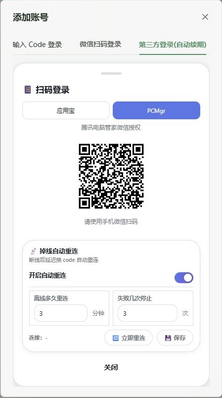

# 第三方登录(自动续期)

在“添加账号”或“编辑账号”的登录标签栏中选择“第三方登录(自动续期)”，再选择应用宝或 PCMgr（腾讯电脑管家），使用手机微信扫描二维码并确认授权。扫码完成后，面板保存授权、取得农场 Code 并启动账号。

## 两个授权渠道

| 渠道 | 授权及续期方式 |
| --- | --- |
| 应用宝 | 使用应用宝微信授权与刷新接口，兼容原有已保存的应用宝授权。 |
| PCMgr | 使用腾讯电脑管家独立的账号、登录密钥及设备标识，通过其原生网关取票据、续期，再换取农场 Code。 |

每个农场账号保存所选渠道的授权。掉线重连继续使用该渠道，不会自动切换到另一渠道。需要更换渠道时，在该账号的编辑窗口重新选择渠道并扫码。原有“输入 Code 登录”“微信扫码登录”和 QQ 扫码流程继续保留。

## 保存与自动重连

“保存”用于保存自动重连开关、离线等待时间和重试上限。未完成授权时保存默认设置；编辑已授权账号时保存该账号设置。“立即重连”用于已经保存第三方授权、处于离线状态且已开启自动重连的账号。

自动重连默认开启，离线等待 **3 分钟**，**每次掉线最多重试 3 次**，每 30 秒扫描一次，因此首次重连可能比设置时间晚一个扫描周期。重连时先刷新所选渠道的授权，再取新票据、换取新的农场 Code 并启动账号；确认恢复在线后清零计数，下次掉线重新获得完整重试次数。仅启动进程或登录失败不会清零；达到上限后停止本轮自动重连，保存设置或手动重连可以重置计数。

游戏请求超时沿用原有恢复策略，不计入普通重试上限；登录受限错误 `1000016` 会关闭自动重连。刷新授权失败时会尝试已保存的 Code。上游撤销授权或刷新失败时，仍可能需要重新扫码，“自动续期”不代表永久免扫码。

## 授权保存与迁移

授权保存在 `core/data/yyb-scan-authorization.enc`，使用 AES-256-GCM 加密；密钥位于同目录的 `yyb-scan-authorization.key`。迁移时复制整个 `core/data`，加密文件和密钥必须一起保留。PCMgr 的登录密钥和设备标识保存在该加密授权中，管理接口不返回访问令牌、刷新令牌或 PCMgr 登录密钥。

## 实现来源与验证范围

扫码与重连面板参考 [QQ-farm-BOT-GO](https://github.com/Aoluis1005/QQ-farm-BOT-GO)；PCMgr 协议字段与调用顺序参考 [YYB-Go-Enhanced c4c2355](https://github.com/525815266/YYB-Go-Enhanced/tree/c4c2355891804bd5e9d8be2caca2033f881624cb/internal/pcmgr)，使用农场自身的 Node.js 实现，无需额外运行 Go 服务或安装电脑管家客户端。

自动测试覆盖渠道校验、PCMgr 授权与密钥续期、票据宿主匹配、加密响应校验、扫码并发与取消，以及重连计数。两个渠道的真实二维码和 PCMgr 网关握手已验证；长期授权有效期和真实掉线后的恢复仍需持续运行验证。
